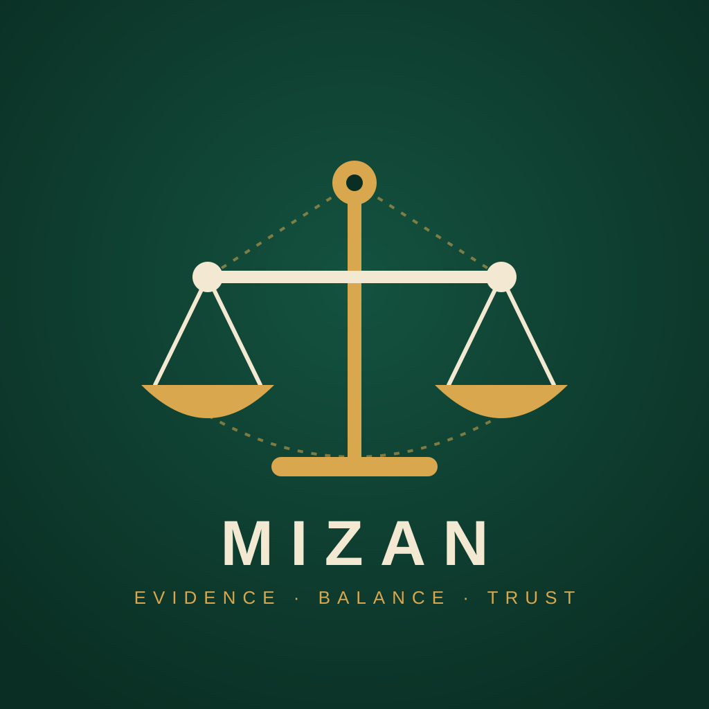
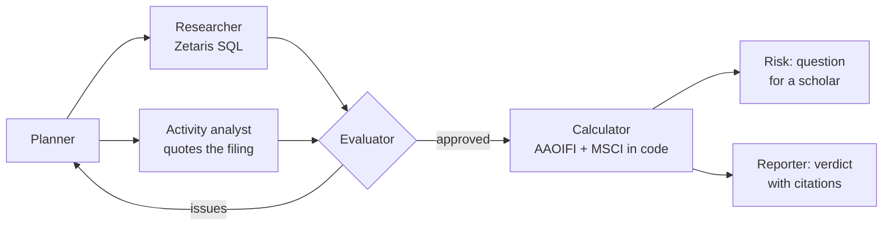

<p align="center"></p>

<h1 align="center">Mizan</h1>

<p align="center"><b>AI agents that check whether a stock is halal (Shariah-compliant), and show the evidence for every verdict.</b></p>

<p align="center">Open Agent Hackathon 2026 · <b>Track 2: The Agent That Can Explain Why</b><br>
Zetaris · Meterless H-MEM · Meterless Nightshift · NVIDIA Nemotron</p>

---

## In 30 seconds

- **Problem:** Muslim investors must avoid companies whose business or finances break Shariah rules. Checking means reading a 100-page filing. Screening apps give a badge with no reasons, disagree with each other, and ignore African markets.
- **Mizan:** type a ticker, and **7 AI agents** research the company's filings through **Zetaris**, check each other's work in a loop, and return an **AAOIFI and MSCI verdict** where **every number links to its source**, down to the filing page.
- **Works on real data:** US stocks (live SEC data) and **6 Nigerian Exchange companies** (audited reports, 30/30 figures verified).
- **Never guesses:** the agents can't record a number or quote they didn't see; doubtful data gives *Needs review*, not a pass.

## Hackathon requirements

| Requirement | How Mizan meets it | Proof |
|---|---|---|
| **Zetaris** integrated (Data) | 16 live SEC REST sources plus Nigerian filing data registered in Zetaris; agents query them with SQL, including one query across all sources | [`scripts/zetaris-setup.ts`](scripts/zetaris-setup.ts), [`src/agents/researcher.ts`](src/agents/researcher.ts) |
| **Meterless engine** in a working feature, with a passing test (Build) | **H-MEM** stores every fact with its source; its trust ledger is the audit trail in the UI | `npm run conformance` → **13/13 pass** · [`src/memory/evidence.ts`](src/memory/evidence.ts) |
| **Meterless Nightshift** as the primary AI provider (Power) | Every model call goes through Nightshift, following the Power Prompt contract | [`src/llm/meterless.ts`](src/llm/meterless.ts) · `npm run check` |
| **NVIDIA Nemotron** doing real work | All agents run on `nemotron-3.5-lightning` via Nightshift, including tool calling; each call logs the model that served it | [`src/agents/llm.ts`](src/agents/llm.ts) · [`runs/`](runs/) |
| Agent **system**, not a pipeline | Planner ↔ researcher ↔ evaluator loop: re-planning, retries, escalation, skipping work that can't change the result | [`src/agents/orchestrator.ts`](src/agents/orchestrator.ts) |
| **Explains why** (Track 2) | Evidence-backed verdicts; each figure opens its source and audit trail | Evidence drawer in the app |
| Logs and traces, sample inputs and outputs | Full trace and report for every run | [`runs/`](runs/) |
| No secrets committed | Keys only in `.env.local` (git-ignored); [`.env.example`](.env.example) has placeholders | |

## Results on real companies

| Company | AAOIFI | MSCI | Why |
|---|---|---|---|
| Apple (US) | ✅ | ✅ | Clean business, low debt |
| JPMorgan (US) | ❌ | ❌ | Conventional bank |
| Constellation Brands (US) | ❌ | ❌ | 10-K: *"producer and marketer of beer, wine, and spirits"* |
| Marriott (US) | ✅ | ❌ | **Standards disagree:** debt is 16% of market cap but 60% of assets |
| **Dangote Cement** (NGX) | ✅ | ✅ | Debt 6.6% of market cap; purify 1.91% of dividends |
| **MTN Nigeria** (NGX) | ✅ | ❌ | Tower-lease debt exceeds MSCI's asset limit |
| **Guinness Nigeria** (NGX) | ❌ | ❌ | Filing: *"brewing… and selling of Guinness"* |
| **Access Holdings** (NGX) | ❌ | ❌ | Bank: the planner stops chasing ratios that can't change the result |

## How it works



Every model call: **agent → Meterless Nightshift → NVIDIA Nemotron**. Every fact: **Zetaris → Meterless H-MEM → evidence drawer**.

## Quick start

```bash
npm install && npm run setup        # install, then vendor the Meterless H-MEM engine
cp .env.example .env.local          # add Zetaris and Nightshift settings
npm run check                       # PASS/FAIL for every layer
npm run zetaris:setup && npm run ngx:load   # register the data sources in Zetaris
npm run dev                         # open http://localhost:5050
```

Needs Node 20+, a Zetaris instance and Meterless Nightshift with an NVIDIA key. Full setup: [docs/DETAILS.md](docs/DETAILS.md#6-run-it-yourself).

## More

- **[Full details](docs/DETAILS.md):** the agents, the screening method, Nigerian data preparation, reliability design, limitations and roadmap.
- **[Technical PRD](docs/TECHNICAL-PRD.md)**

*Mizan gives a screening result, not a fatwa. the Meterless H-MEM engine (Apache 2.0) is vendored at setup.*
