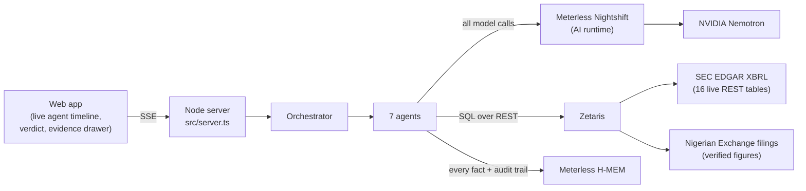
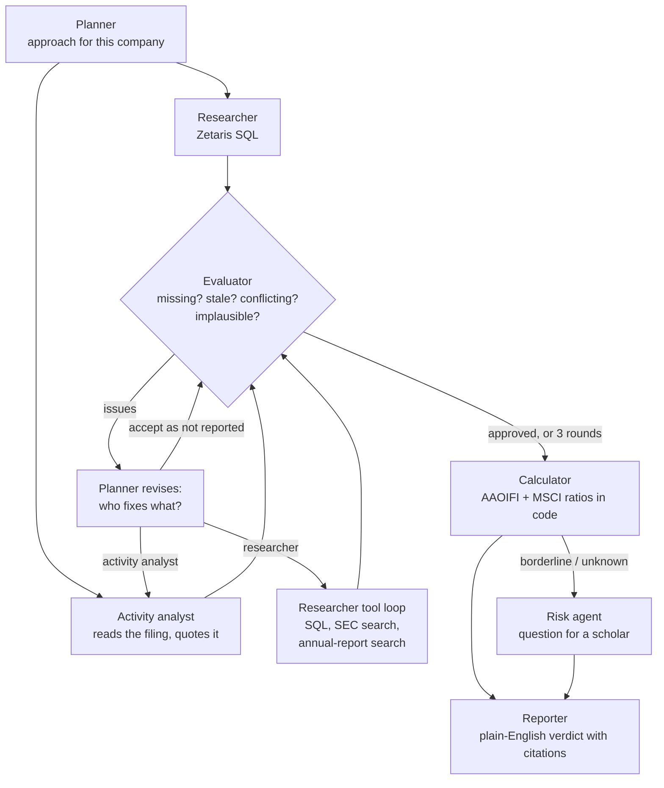

<p align="center"></p>

<h1 align="center">Mizan</h1>

<p align="center"><b>AI agents that check whether a stock is Shariah-compliant, and show the evidence for every verdict.</b><br>
US stocks (SEC EDGAR) and the Nigerian Exchange (audited annual reports), screened against AAOIFI and MSCI.</p>

<p align="center">Open Agent Hackathon 2026 · Track 2: <i>The Agent That Can Explain Why</i><br>
Built with <b>Zetaris</b> (data) · <b>Meterless H-MEM</b> (memory) · <b>Meterless Nightshift</b> (AI runtime) · <b>NVIDIA Nemotron</b> (reasoning)</p>

---

## Contents

1. [The problem](#1-the-problem)
2. [What Mizan does](#2-what-mizan-does)
3. [Results on real companies](#3-results-on-real-companies)
4. [How it works](#4-how-it-works)
5. [Sponsor technology, and where to find it in the code](#5-sponsor-technology-and-where-to-find-it-in-the-code)
6. [Run it yourself](#6-run-it-yourself)
7. [The screening method](#7-the-screening-method)
8. [Nigerian Exchange support](#8-nigerian-exchange-support)
9. [Evidence for judges](#9-evidence-for-judges)
10. [Project structure](#10-project-structure)
11. [Limitations and honest notes](#11-limitations-and-honest-notes)
12. [What comes next](#12-what-comes-next)

---

## 1. The problem

Islamic finance asks Muslim investors to avoid two kinds of company:

- **Businesses that are impermissible at their core:** conventional interest-based banking and insurance, alcohol, gambling, pork, tobacco and similar.
- **Businesses that lean too heavily on interest:** too much interest-bearing debt, too much money parked in interest-bearing deposits, or too much income from interest.

Standards such as **AAOIFI Shariah Standard No. 21** turn this into tests: for example, *interest-bearing debt must be below 30% of the company's market value*.

Checking a single stock means reading a 100-page filing, finding the right numbers in the balance sheet and notes, and doing the arithmetic. Most investors can't do that. Screening apps give a green or red badge **with no reasons**, different apps disagree **without saying why**, and almost none cover **African markets**.

## 2. What Mizan does

Type a ticker, for example `AAPL` or `DANGCEM`. A team of AI agents:

1. **Plans** the screen for that specific company.
2. **Researches** the figures through **Zetaris**, a single SQL query across many live data sources.
3. **Reads the company's own filing** to judge what the business actually does, and quotes it.
4. **Checks its own work.** An evaluator agent rejects missing, out-of-date, conflicting or implausible numbers and sends the researcher back.
5. **Calculates** the AAOIFI and MSCI ratios with ordinary code. The AI never does the arithmetic.
6. **Escalates** cases it can't settle, with a specific question for a Shariah scholar.
7. **Explains** the verdict in plain English, including how much of each dividend to give to charity (the purification rate).

**Every number in the verdict is clickable.** It opens the source filing (down to the PDF page for Nigerian companies) and an **audit trail** of which agent found it, checked it, rejected it or replaced it.

> Mizan gives a screening result, not a fatwa.

## 3. Results on real companies

These are real runs. Their full traces are in [`runs/`](../runs/).

| Company | Market | AAOIFI | MSCI | Why |
|---|---|---|---|---|
| **Apple** (AAPL) | US | ✅ Compliant | ✅ Compliant | No non-compliant business in the 10-K; debt is 1.6% of market cap |
| **Tesla** (TSLA) | US | ✅ Compliant | ✅ Compliant | Clean business; low debt |
| **JPMorgan** (JPM) | US | ❌ Not compliant | ❌ Not compliant | Conventional bank; interest income is 15% of revenue |
| **Constellation Brands** (STZ) | US | ❌ Not compliant | ❌ Not compliant | Quoted from its 10-K: *"producer and marketer of beer, wine, and spirits"* |
| **Marriott** (MAR) | US | ✅ Compliant | ❌ Not compliant | **The standards disagree:** debt is 16.5% of market cap (AAOIFI passes) but 60% of total assets (MSCI fails) |
| **Dangote Cement** (DANGCEM) | NGX | ✅ Compliant | ✅ Compliant | Cement business; debt is 6.6% of market cap; purify 1.91% of dividends |
| **MTN Nigeria** (MTNN) | NGX | ✅ Compliant | ❌ Not compliant | Tower-lease liabilities push debt above MSCI's limit against assets |
| **BUA Foods** (BUAFOODS) | NGX | ✅ Compliant | ❌ Not compliant | ₦754 billion owed by related BUA companies fails MSCI's receivables test |
| **Access Holdings** (ACCESSCORP) | NGX | ❌ Not compliant | ❌ Not compliant | Bank. The planner stops chasing financial ratios because they can't change the result |
| **Guinness Nigeria** (GUINNESS) | NGX | ❌ Not compliant | ❌ Not compliant | Quoted from its NGX filing: *"brewing, packaging, marketing and selling of Guinness"* |

## 4. How it works

### Architecture



### The agent loop

This is a loop, not a straight pipeline. The evaluator can send work back, and the planner decides who handles each problem.



### The seven agents

| Agent | What it does | Model | Code |
|---|---|---|---|
| **Planner** | Writes the approach for the company; after each evaluation, decides who fixes each problem; skips work that can't change the verdict | Nemotron | `src/agents/planner.ts` |
| **Researcher** | Round 1: one Zetaris query across every source. Later rounds: a tool-using loop (`run_sql`, `xbrl_search`, `filing_search`, `record_fact`, `give_up`). **It can only record numbers that appeared in a tool result.** | Nemotron (tool calling) | `src/agents/researcher.ts` |
| **Activity analyst** | Reads the business section of the 10-K or annual report and estimates non-compliant revenue. **Quotes not found in the filing are dropped.** | Nemotron | `src/agents/activity.ts` |
| **Evaluator** | Rule checks first (missing, older than 15 months, two sources disagreeing by >5%, debt larger than assets), then a Nemotron review for figures that don't make sense for this company | Rules + Nemotron | `src/agents/evaluator.ts` |
| **Calculator** | AAOIFI and MSCI ratios, borderline detection, purification rate. Plain TypeScript with unit tests | none | `src/calc/` |
| **Risk** | For "needs review" cases, writes the single most useful question for a scholar | Nemotron | `src/agents/reporter.ts` |
| **Reporter** | Plain-English verdict citing evidence IDs; falls back to a calculator-built summary if the model is unavailable | Nemotron | `src/agents/reporter.ts` |

### Built to be reliable

- **No invented numbers:** the researcher's `record_fact` is rejected unless the value appeared in a tool result.
- **No invented quotes:** activity quotes are checked against the filing text.
- **No silent guesses:** a figure the evaluator doubts and nobody replaces is **excluded**, so the test reads "Needs review" instead of passing.
- **Conservative data choices:** when a filing supports several debt measures, the largest is used, so a screen can only get stricter.
- **Model failures don't sink a run:** calls are queued with retries; the planner, activity analyst and reporter each have fallbacks.

## 5. Sponsor technology, and where to find it in the code

### Zetaris: the data layer

- **SEC data as live Zetaris sources.** `scripts/zetaris-setup.ts` registers 16 SEC XBRL "frames" (assets, debt in all its forms, cash, securities, receivables, revenue, interest income, each covering *every* US filer) as `CREATE LIGHTNING REST TABLE` sources, plus flattened `SCHEMASTORE VIEW`s in the `mizan` container.
- **Nigerian filings in the same place.** `scripts/ngx-load.ts` registers `mizan.ngx_companies`, `mizan.ngx_facts` and `mizan.ngx_prices` alongside them.
- **One query across sources.** The researcher's first move is a single `UNION ALL` query over every source for the company (`src/agents/researcher.ts`, `gatherFromZetaris`). In later rounds it writes its own read-only SQL.
- **Client:** `src/data/zetaris.ts`. It uses REST with `X-Org-ID`, a fresh `X-Request-ID` and a bearer API key, falling back to the documented `/query/sql/start` API.

### Meterless H-MEM: the Build engine

- **Every fact, quote and derived figure is an H-MEM record** with a mandatory `source` and `provenance` (`src/memory/evidence.ts`).
- **The trust ledger** records which agent *created*, *read*, *rejected* (H-MEM `wrong` feedback, which lowers confidence) or *superseded* each record. That ledger **is** the audit trail in the UI's evidence drawer.
- **Proof:** `npm run conformance` runs the official H-MEM conformance suite against the engine entry Mizan uses (`src/memory/hmem.ts`): **13/13 checks pass**.

### Meterless Nightshift: the Power runtime

- **Nightshift is the app's primary and only AI provider** (`src/llm/meterless.ts`), implementing the Power Prompt contract:
  - `Authorization: Bearer` with the runtime token; `meterless-app: mizan` on every call; `meterless-scope: user` on chat.
  - `GET /v1/models` for discovery; only a successful model list counts as "online".
  - 401/403 reported as **unauthorized**, never "offline"; the placeholder `rt-local` is rejected.
  - URL normalisation, a Quick Connect link parser, auto-detection across ports 8088/8090/8787/11434, and a 180-second timeout.
- **Live status:** `npm run check` and the UI's status lights test the connection without exposing keys.

### NVIDIA Nemotron: the reasoning

- **All six model-using agents run on Nemotron through Nightshift**, pinned to `nvidia/nemotron-3.5-lightning-30b-a3b` (configurable with `METERLESS_MODEL_FAST` / `METERLESS_MODEL_DEEP`).
- **Nemotron's tool calling drives the researcher.** It decides which Zetaris SQL to run and which filing to search.
- **Every call is logged** with the model Nightshift reports serving it (`runs/*.jsonl`, `"type":"llm"` events), so the evidence that Nemotron did the work is unambiguous.

### Coding tool

Cursor became optional during the event. Mizan was built with **Claude Code**.

## 6. Run it yourself

### What you need

| Requirement | Why | How |
|---|---|---|
| **Node.js 20+** | Runs Mizan | [nodejs.org](https://nodejs.org) |
| **A Zetaris instance** | The data layer | Local Docker, or a Mini cluster on AWS Free Tier, per [Zetaris getting started](https://zetaris.github.io/getting-started). Create an API key in **Management → API tokens** |
| **Meterless Nightshift** | The AI runtime | Install from [meterless.ai](https://meterless.ai). Add your NVIDIA key in **Setup → Providers**, put a Nemotron model in a lane, and copy the URL and API key from **Console** |
| **An NVIDIA API key** | Nemotron | [build.nvidia.com](https://build.nvidia.com). It goes into Nightshift, not into Mizan |

### Step by step

```bash
# 1. Get the code and install
git clone <this repo> mizan && cd mizan
npm install

# 2. Vendor the Meterless H-MEM engine and its conformance suite (into vendor/, git-ignored)
npm run setup

# 3. Settings: copy the template and fill in your values
cp .env.example .env.local
```

`.env.local` (never committed):

| Setting | Example | Where it comes from |
|---|---|---|
| `ZETARIS_REST_URL` | `https://api.<cluster-id>.cloud.zetaris.com/api/v1.0` or `http://localhost:8888/api/v1.0` | Your Zetaris instance |
| `ZETARIS_ORG_ID` | `1` | Zetaris → Management → Organisation |
| `ZETARIS_API_KEY` | | Zetaris → Management → API tokens |
| `METERLESS_BASE_URL` | `http://127.0.0.1:8088/v1` | Nightshift → Console |
| `METERLESS_RUNTIME_TOKEN` | | Nightshift → Console (the real key, not `rt-local`) |
| `METERLESS_MODEL` | `meterless/auto` | Optional |
| `SEC_USER_AGENT` | `"mizan you@example.com"` | Your contact; SEC requires one |

```bash
# 4. Check every layer: prints PASS/FAIL, never prints keys
npm run check

# 5. Register Mizan's sources in Zetaris (idempotent)
npm run zetaris:setup     # SEC XBRL frames
npm run ngx:load          # Nigerian Exchange figures

# 6. Start the app
npm run dev               # open http://localhost:5050
```

### All commands

| Command | What it does |
|---|---|
| `npm run dev` | Web app at http://localhost:5050 |
| `npm run screen -- AAPL` | Screen from the terminal and watch the agents work |
| `npm run check` | PASS/FAIL for SEC, Zetaris, Nightshift and a Nemotron reply |
| `npm test` | Calculator unit tests |
| `npm run conformance` | Meterless H-MEM conformance suite (13 checks) |
| `npm run ngx:verify` | Checks all 30 Nigerian figures against the filing text |
| `npm run zetaris:setup` | Registers the SEC sources in Zetaris |
| `npm run ngx:load` | Loads the Nigerian figures into Zetaris |
| `npm run sql -- "<SQL>"` | Runs one SQL statement on Zetaris |
| `npm run models -- nemotron` | Lists the Nemotron models Nightshift exposes |
| `npm run ingest` | Rebuilds the US demo dataset CSVs in `data/out/` |

## 7. The screening method

| Test | AAOIFI SS-21 | MSCI (comparison) |
|---|---|---|
| Revenue from non-compliant business | below 5% | below 5% |
| Interest-bearing debt | below 30% of **market cap** | below 33.33% of **total assets** |
| Cash and interest-bearing securities | below 30% of market cap | below 33.33% of total assets |
| Receivables, cash and securities | — | below 33.33% of total assets |
| Non-compliant (interest) income | below 5% of revenue | below 5% of revenue |

- **Verdicts:** *Compliant* (every test passes), *Not compliant* (any test fails), *Needs review* (data missing or a result within 10% of a limit).
- **Missing data never passes.**
- **Purification rate:** interest income ÷ revenue, plus the non-compliant revenue share. That's the part of each dividend to give to charity.
- Thresholds are data, in `src/calc/standards.ts`. Adding a standard is a data change, not a code change.

## 8. Nigerian Exchange support

Halal screening tools almost never cover African markets. Mizan screens six Nigerian Exchange companies with the same agents and standards.

| Ticker | Company | Filing used |
|---|---|---|
| DANGCEM | Dangote Cement | Audited FY2025 statements (NGX document library) |
| MTNN | MTN Nigeria | Audited FY2025 statements (NGX document library) |
| NESTLE | Nestlé Nigeria | 2025 annual report with audited statements |
| BUAFOODS | BUA Foods | 2025 audited financial statements |
| GUINNESS | Guinness Nigeria | Q1 2026 statements (NGX); used for business activity |
| ACCESSCORP | Access Holdings | Q3 2025 statements; used for business activity |

**How the data was prepared:**
1. Several statements are **scanned images with no text layer**. Those figures were read from the page images and **cross-checked against the same figures in the notes text**.
2. Every figure is in [`data/ngx/filings.json`](../data/ngx/filings.json) with its **PDF page** and the line it came from.
3. `npm run ngx:verify` confirms **every printed number appears in the filing text (30/30)**. The extracted text ships in `data/ngx/text/`.
4. `npm run ngx:load` registers the figures in **Zetaris**, where the agents query them like any other source.
5. **Prices:** the NGX's official market data API is paid, so Mizan uses a **dated closing-price snapshot (22 Oct 2026)** and cites its source.

**Judgement calls, made visible in the evidence:**
- **MTN:** IFRS 16 lease liabilities (mostly tower leases) carry interest, so they're counted as interest-bearing debt.
- **BUA Foods:** amounts due from related BUA companies are counted as receivables.

Both choices are conservative and appear as separate components, so a reviewer can disagree with them openly.

## 9. Evidence for judges

| Where | What it shows |
|---|---|
| [`runs/*.jsonl`](../runs/) | The full trace of every run: each agent step, tool call, SQL statement, model call (with the model that served it) and decision |
| [`runs/*.report.json`](../runs/) | Final verdicts, every ratio with its evidence IDs, the narrative and any escalation |
| The UI's evidence drawer | Click any `mem-…` chip to see the source, a link to the filing, and the H-MEM audit trail |
| `npm run conformance` | H-MEM conformance, 13/13 |
| `npm run ngx:verify` | Nigerian figures checked against the filings, 30/30 |
| `npm test` | Calculator unit tests |

> Agent memory itself is stored locally in `.hmem/` (git-ignored, because Meterless memory stays on the machine). Each run's evidence is reproduced in its trace and report files.

## 10. Project structure

```
mizan/
├── src/
│   ├── agents/          planner, researcher, activity analyst, evaluator, risk/reporter, orchestrator, tools, trace
│   ├── calc/            AAOIFI + MSCI standards and the deterministic calculator
│   ├── data/            SEC EDGAR, XBRL extraction, Zetaris client, SEC frames, NGX, prices
│   ├── llm/             Meterless Nightshift provider (Power contract)
│   ├── memory/          H-MEM evidence store and the engine entry used by conformance
│   └── server.ts        web server and SSE streaming API
├── web/                 the web app (plain HTML/CSS/JS, no build step)
├── scripts/             CLI: screen, check, conformance, Zetaris setup, NGX verify/load, ingest, sql
├── data/
│   ├── ngx/             verified Nigerian filing figures, prices, extracted filing text
│   └── out/             US demo dataset (CSV)
├── runs/                sample run traces and reports
├── test/                calculator unit tests
└── docs/TECHNICAL-PRD.md
```

## 11. Limitations and honest notes

- **NVIDIA's free hosted endpoints are slow and sometimes fail under load.** A screen takes 2–6 minutes. Mizan queues model calls, retries, and falls back rather than failing; past runs replay instantly in the UI.
- **AAOIFI thresholds** come from published methodology summaries and are marked *to verify* against the primary standard text in `src/calc/standards.ts`.
- **XBRL data is messy.** Some companies (for example Ford) use custom tags for debt; Mizan reports *Needs review* rather than guessing.
- **Nigerian coverage is six companies** prepared from their filings, not a live feed, because there is no free structured data source for NGX filings.
- **Business-activity shares** for companies like hotels are estimates from the filing text. Unquantifiable cases go to a scholar instead of passing.

## 12. What comes next

- **More markets:** the full NGX, plus other exchanges where Muslim investors are underserved.
- **Upload any annual report:** the same verified-extraction pipeline, run on demand.
- **Watchlists and alerts** when a holding's status changes after a new filing.
- **Scholar review workflow** for escalated cases, with the scholar's answer stored as evidence.

## Pre-existing components

- Meterless H-MEM reference engine and conformance suite (Apache 2.0), vendored by `npm run setup`.
- Open-source developer tools: TypeScript, tsx, Vitest.
- All Mizan code, data preparation and documentation was produced during the build window (22–27 October 2026).

## License

Apache 2.0.
